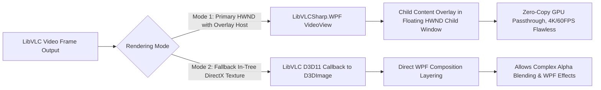
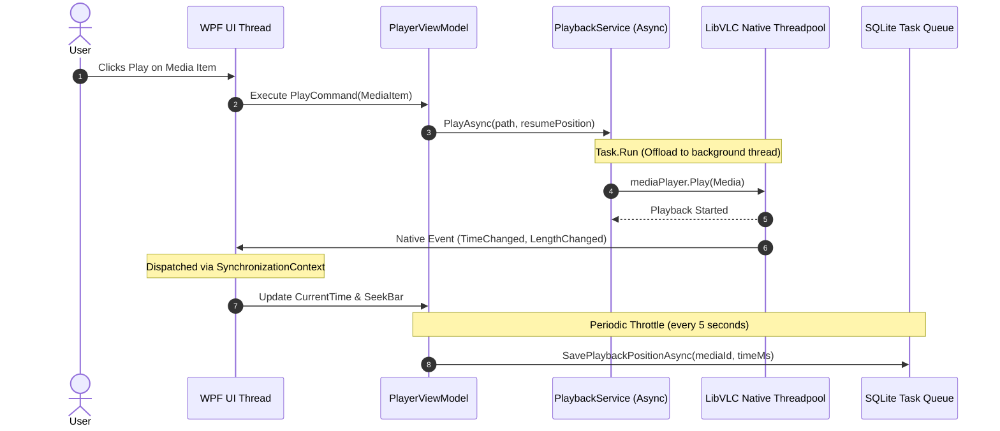

# NovaPlayer — System Architecture Document

## 1. Architectural Principles & Overview

NovaPlayer follows a modern, modular **Clean Architecture** combined with the **MVVM (Model-View-ViewModel)** design pattern. It enforces strict separation of concerns, loose coupling through dependency injection (`Microsoft.Extensions.DependencyInjection`), deterministic resource disposal, and non-blocking asynchronous I/O across all layers.

### High-Level Architectural Diagram

```mermaid
graph TD
    subgraph Presentation Layer ["1. Presentation Layer (WPF / XAML)"]
        UI_Views["Views & Controls (MainWindow, VideoView, LibraryView, Dialogs)"]
        UI_Styles["Themes, Resource Dictionaries, Converters"]
        UI_VM["ViewModels (PlayerViewModel, LibraryViewModel, DownloadViewModel)"]
    end

    subgraph Application Layer ["2. Application / Core Service Layer"]
        App_Commands["User Commands & Orchestrators"]
        App_Interfaces["Service Interfaces (IPlayerService, ILibraryService, IDownloadService)"]
        App_DTOs["Data Transfer Objects, Events & Notifications"]
    end

    subgraph Infrastructure Layer ["3. Infrastructure Layer"]
        Infra_Playback["Playback Engine (LibVLCSharp Wrapper, Hardware Accel Config)"]
        Infra_Data["Persistence (SQLite / Microsoft.Data.Sqlite Repository)"]
        Infra_Download["Download Engine (HttpClient, Resumable Chunk Manager)"]
        Infra_IO["File System Scanner & Metadata Parser"]
        Infra_Logging["Serilog Structured Logger & Diagnostics"]
    end

    subgraph Native Layer ["4. Native Runtime & External Dependencies"]
        Native_LibVLC["LibVLC Native Binaries (libvlc.dll, libvlccore.dll, /plugins/)"]
        Native_SQLite["e_sqlite3.dll"]
    end

    UI_Views --> UI_VM
    UI_VM --> App_Interfaces
    App_Interfaces <|.. Infra_Playback
    App_Interfaces <|.. Infra_Data
    App_Interfaces <|.. Infra_Download
    App_Interfaces <|.. Infra_IO
    App_Interfaces <|.. Infra_Logging

    Infra_Playback --> Native_LibVLC
    Infra_Data --> Native_SQLite
```

---

## 2. Layer Responsibilities & Dependency Direction

### 2.1 Dependency Inversion Principle (DIP)
Dependencies flow inward toward domain abstractions. The UI and Infrastructure layers depend upon Core abstractions (`Nova.Core`), never directly upon each other.

| Layer | Project Assembly | Key Responsibilities | Allowed Dependencies |
| :--- | :--- | :--- | :--- |
| **Presentation** | `Nova.App` | XAML Views, custom user controls, value converters, view models, application bootstrapper. | `Nova.Core`, `CommunityToolkit.Mvvm`, `LibVLCSharp.WPF` |
| **Core (Domain/App)** | `Nova.Core` | Entities, value objects, service contracts (`IPlaybackService`, `ILibraryRepository`), domain events, DTOs, result types. | None (Clean POCO, standard library only) |
| **Infrastructure** | `Nova.Infrastructure` | LibVLC adapter implementation, SQLite repositories, HttpClient downloader, metadata extraction, logging configuration. | `Nova.Core`, `LibVLCSharp`, `Microsoft.Data.Sqlite`, `Serilog` |

---

## 3. Playback Architecture & WPF Airspace Solution

### 3.1 The Airspace Challenge in WPF
WPF renders using a DirectX composition tree managed by `DirectWrite` and `milcore`. LibVLC's default high-performance video sink (`direct3d11` or `direct3d9`) outputs directly to an OS window handle (HWND). In standard WPF, an HWND hosted via `HwndHost` cuts through the WPF visual tree (the notorious "airspace problem"), rendering all sibling WPF elements underneath the video surface invisible.

### 3.2 NovaPlayer Airspace Mitigation Strategy
NovaPlayer utilizes a two-tier strategy:



1. **Primary Mode (High Performance HWND Overlay)**:
   * Uses `LibVLCSharp.WPF.VideoView`.
   * UI controls (OSD, seek bar, play/pause buttons, track selectors) are nested directly inside `<vlc:VideoView>...</vlc:VideoView>`.
   * `LibVLCSharp.WPF` automatically positions a transparent child window containing the nested WPF elements precisely over the video HWND, synchronized with window move/resize events.
   * Delivers maximum performance, zero memory-copy video rendering, and native GPU hardware acceleration for 4K HEVC/AV1.

2. **Window Message Forwarding**:
   * Mouse and keyboard events on the video window are intercepted and routed to the `PlayerViewModel` so that double-clicking for fullscreen, mouse-wheel volume adjustment, and hotkeys function seamlessly across the entire surface.

---

## 4. Threading Model & Concurrency

NovaPlayer operates on a strict multi-threaded architecture to guarantee that the UI thread never freezes.



### Threading Rules:
1. **UI Thread (WPF Dispatcher)**: Strictly reserved for rendering, animations, user input events, and ViewModel property updates. Never perform file I/O, database access, or blocking network calls on this thread.
2. **LibVLC Native Threadpool**: Native C threads created by LibVLC manage decoding, demuxing, and hardware presentation. LibVLC events (`TimeChanged`, `Buffering`, `EndReached`) fire on native threads.
3. **Synchronization Context**: The `PlaybackService` intercepts LibVLC events and dispatches them to the WPF `Dispatcher` (or UI `SynchronizationContext`) using throttled updates (e.g., seekbar updates capped at 10 Hz) to eliminate Dispatcher saturation.
4. **I/O & Persistence Threads**: SQLite queries and media file indexing execute via async/await using `Task.Run` and `IAsyncEnumerable`.
5. **Download Workers**: The `DownloadService` manages background tasks with thread-safe cancellation tokens, progress reporting throttled to 4 Hz, and asynchronous buffered stream writes.

---

## 5. Resource Lifecycle & Deterministic Disposal

LibVLC utilizes unmanaged C pointers. Failure to dispose of native objects in the correct order results in memory leaks or native access violations (`0xC0000005`).

### 5.1 Object Hierarchy & Disposal Order
```mermaid
graph TD
    A[LibVLC Core Engine (Singleton per App Domain)] --> B[MediaPlayer Instance (Scoped to Player Session)]
    B --> C[Media Instance (Transient per Playable Item)]
    C --> D[Native Buffers & Decoder Contexts]
```

* **`LibVLC` (Core Engine)**: Initialized once at application startup via `LibVLCSharp.Shared.Core.Initialize()`. Wrapped as a singleton service in DI (`ISingletonVlcInstance`). Disposed only upon application shutdown.
* **`MediaPlayer`**: Created once per player lifetime. Bound to the `VideoView`. Reused across media tracks. Disposed when closing the application or when tearing down the player view.
* **`Media`**: Instantiated when a new track or URL is requested. The previous `Media` object is explicitly disposed **before** creating or assigning the new `Media` object.
* **SQLite Connection**: Managed via a thread-safe connection factory with WAL (Write-Ahead Logging) enabled.

---

## 6. Error Handling Strategy & Fault Tolerance

NovaPlayer enforces structured error resilience across three distinct rings:

```mermaid
flowchart TD
    subgraph Ring 1 ["Ring 1: Outer Shell (Global Unhandled)"]
        G1[AppDomain.CurrentDomain.UnhandledException]
        G2[DispatcherUnhandledException]
        G3[TaskScheduler.UnobservedTaskException]
    end

    subgraph Ring 2 ["Ring 2: Service Layer (Result Pattern)"]
        S1[PlaybackResult.Failure(reason)]
        S2[DownloadResult.Failed(exception)]
        S3[DatabaseResult<T>]
    end

    subgraph Ring 3 ["Ring 3: Hardware & Native (LibVLC Log Sink)"]
        N1[LibVLC Native Log Callback]
        N2[Hardware Fallback: D3D11 -> DXVA2 -> Software]
    end

    G1 & G2 & G3 --> L[Serilog Structured File Log]
    S1 & S2 & S3 --> UI_Alert[User-Friendly Notification Toast / Dialog]
    N1 --> L
```

1. **Hardware Fallback Chain**:
   If hardware-accelerated decoding fails during playback initialization (e.g., driver incompatibility), LibVLC automatically attempts fallback to software decoding. If unrecoverable, `PlaybackService` reports a structured `PlaybackFailureException` and offers to switch default decoding mode to Software.
2. **Operation Result Pattern**:
   Services return `Result<T>` or `Result` objects containing explicit error codes and user-safe messages, avoiding raw exceptions for operational failures (file not found, network timeout, unsupported stream).
3. **Crash Reporting**:
   Unhandled crashes write an emergency minidump or exception trace to `%LOCALAPPDATA%\NovaPlayer\crashes\` and display a recovery dialog allowing safe restart.

---

## 7. Security & Downloader Architecture

### 7.1 Resumable Download Engine
1. **Streaming Architecture**:
   * Uses `HttpClient` with `HttpCompletionOption.ResponseHeadersRead` and 64 KB memory-bounded buffers (`new byte[65536]`).
   * Bounded memory footprint guarantees zero whole-file memory buffering regardless of download size (multi-gigabyte video files).
   * Throttled telemetry updates UI Dispatcher at most 4 Hz (250ms interval) calculating rolling transfer speed and ETA.
2. **Resumable HTTP Range Mechanics**:
   * Uses `.part` staging files (`{DestinationPath}.part`).
   * When resuming, issues `Range: bytes={existingBytes}-` and `If-Range: {etag}`.
   * Requires `206 Partial Content` with matching `Content-Range: bytes START-END/TOTAL`.
   * Rejects `200 OK` as an appendable response (restarts from byte 0 to prevent corruption).
   * Validates resource freshness: if `ETag` or `Last-Modified` changed since partial download started, the partial file is deemed stale, purged, and restarted from byte 0.
   * Atomic promotion: on verified completion, flushes buffers, closes streams, verifies destination non-collision, and invokes `File.Move(tempPath, destPath, overwrite: false)`.

### 7.2 Security Hardening & SSRF Defense
1. **Strict Scheme & Credential Validation**:
   * Permits only `http` and `https` schemes.
   * Explicitly rejects URLs containing embedded user credentials (`user:password@host`) via `uri.UserInfo`.
2. **DNS Resolution & Prohibited IP Filtering**:
   * Resolves target hostname prior to issuing requests.
   * Prohibits connection to:
     * IPv4 Loopback (`127.0.0.0/8`, `0.0.0.0/8`)
     * IPv4 Private (`10.0.0.0/8`, `172.16.0.0/12`, `192.168.0.0/16`)
     * IPv4 Link-Local (`169.254.0.0/16`, including AWS/cloud metadata services)
     * IPv4 Multicast/Broadcast (`224.0.0.0/4`, `255.255.255.255`)
     * IPv4 Carrier-Grade NAT (`100.64.0.0/10`)
     * IPv6 Loopback (`::1`), Link-Local (`fe80::/10`), Unique Local (`fc00::/7`), Multicast (`ff00::/8`)
     * IPv4-mapped IPv6 addresses (`::ffff:127.0.0.1`, `::ffff:192.168.x.x`).
3. **Manual Redirect Loop Protection**:
   * `HttpClientHandler.AllowAutoRedirect` is disabled.
   * Redirects (301, 302, 303, 307, 308) are followed manually up to a maximum limit of 5 hops.
   * Every redirect destination URL is independently re-validated against scheme, credential, and SSRF address restrictions before sending subsequent requests.
4. **Filesystem Traversal & Collision Protection**:
   * Filenames sanitized against path traversal (`../`, `..\`) and illegal Windows NTFS characters (`<>:"/\|?*`).
   * Trailing periods and spaces trimmed.
   * Windows reserved device names (`CON`, `PRN`, `AUX`, `NUL`, `COM1-9`, `LPT1-9`) neutralized with safe generated prefixes.
   * Output path containment verified via `Path.GetFullPath` to ensure it remains strictly inside the user's chosen destination directory.
   * Non-destructive collision handler generates `file (1).ext`, `file (2).ext` rather than silently overwriting user data.
5. **Known Networking Limitations**:
   * DNS Rebinding Defense: DNS is resolved at check time. While manual redirect inspection prevents redirection to internal IPs, advanced DNS rebinding where a malicious authoritative nameserver returns a public IP on initial query and an internal IP on secondary socket connection within TTL windows can only be completely eliminated with socket-level IP connection pinning (e.g. SocketsHttpHandler `ConnectCallback`).
   * Encrypted Streams: Downloader does not circumvent DRM, Widevine, PlayReady, or token-locked session streams. Only legally accessible, permitted direct files are supported.
