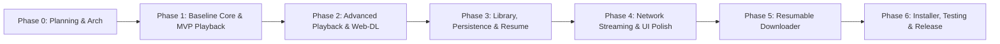

# NovaPlayer — Phased Implementation Plan

This document establishes the step-by-step implementation sequence for NovaPlayer. Each phase is subdivided into discrete, ordered tasks with explicit prerequisites, deliverables, verification procedures, and completion gates.

Implementation work must strictly adhere to the phase order and cannot proceed without meeting the completion gate of the preceding phase.

---

## Roadmap Overview

---

## Phase 0: Architecture, Planning & Environment Setup (CURRENT)
* **Goal**: Establish technical blueprints, analyze dependencies, verify environment, define test strategies, and secure technical alignment.
* **Prerequisites**: Workspace initialization.
* **Tasks**:
  * [x] Task 0.1: Inspect workspace and discover installed SDKs and runtimes (`dotnet --info`, VS 2026 check).
  * [x] Task 0.2: Author `PRODUCT_SPEC.md` covering scope, user workflows, and functional requirements.
  * [x] Task 0.3: Author `ARCHITECTURE.md` covering clean architecture, WPF airspace solution, and threading.
  * [x] Task 0.4: Author `FEATURE_MATRIX.md` defining priorities, acceptance criteria, and limitations.
  * [x] Task 0.5: Author `PROJECT_STRUCTURE.md` establishing modular solution layout.
  * [x] Task 0.6: Author `IMPLEMENTATION_PLAN.md` with structured tasks and gates.
  * [x] Task 0.7: Author `TEST_PLAN.md` defining unit, integration, UI, and performance tests.
  * [x] Task 0.8: Author `DECISIONS.md` documenting architectural decisions (ADRs) and trade-offs.
  * [x] Task 0.9: Author `PROGRESS.md` and root `README.md`.
* **Deliverables**: Complete suite of 9 specification documents in `docs/` and root `README.md`.
* **Completion Gate**: Architecture review and explicit user approval before any code or project files are created.

---

## Phase 1: Core Foundation & Baseline Playback (MVP Core)
* **Goal**: Establish the .NET solution, dependency injection, logging, core domain models, and a functional video player window playing local media files.
* **Prerequisites**:
  * Phase 0 approval.
  * .NET 8.0 SDK installed on the development host.
* **Tasks**:
  * **Task 1.1 (Solution Scaffolding)**:
    * Initialize `NovaPlayer.sln`, `src/Nova.Core`, `src/Nova.Infrastructure`, `src/Nova.App`, and test projects.
    * Configure `Directory.Build.props` (Nullable enable, C# 12, WarningsAsErrors for code quality).
    * Add NuGet dependencies: `LibVLCSharp.WPF`, `VideoLAN.LibVLC.Windows`, `Microsoft.Extensions.DependencyInjection`, `Serilog.Sinks.File`, `CommunityToolkit.Mvvm`.
  * **Task 1.2 (Logging & Diagnostics)**:
    * Implement `LoggingConfigurator` using Serilog rolling file logger (`%LOCALAPPDATA%\NovaPlayer\logs`).
    * Implement global exception handler in `App.xaml.cs`.
  * **Task 1.3 (LibVLC Native Engine Wrapper)**:
    * Implement `LibVlcInstanceFactory` with safe initialization (`Core.Initialize()`).
    * Implement `LibVlcPlaybackService` implementing `IPlaybackService` (Play, Pause, Stop, Seek, Volume, Mute).
  * **Task 1.4 (Player UI & Airspace Integration)**:
    * Create `MainWindow.xaml` hosting `LibVLCSharp.WPF.VideoView`.
    * Place overlay controls (Play/Pause, Seek slider, Volume, Fullscreen) nested within `VideoView` to solve airspace occlusion.
    * Implement `PlayerViewModel` using `CommunityToolkit.Mvvm`.
  * **Task 1.5 (Keyboard & Input Handling)**:
    * Bind hotkeys (`Space`, `Left/Right`, `Up/Down`, `F`, `Escape`) to ViewModel commands.
    * Implement mouse double-click for fullscreen toggle and auto-hiding OSD timer (2.5s).
* **Deliverables**: Working WPF desktop application capable of opening and playing MP4, MKV, and MP3 files from disk with playback controls and fullscreen support.
* **Verification Steps**:
  * Execute `dotnet test` on `Nova.Core.Tests`.
  * Launch `Nova.App`, open local test video (`BigBuckBunny.mp4`), verify video renders, audio plays, pause/seek responds, fullscreen expands, and hotkeys work.
* **Completion Gate**: Local playback works reliably with zero UI freezes and clean application shutdown without native memory leaks.

---

## Phase 2: Advanced Media Playback & Web-DL Support
* **Goal**: Comprehensive codec compatibility, multi-audio switching, subtitle rendering/sync, variable playback speed, aspect ratio scaling, and media info.
* **Prerequisites**: Phase 1 completed and verified.
* **Tasks**:
  * **Task 2.1 (Multi-Audio Track Selection & Audio Delay)**:
    * Expose audio track enumeration from LibVLC in `PlaybackService`.
    * Implement audio track selector in UI.
    * Implement audio delay adjustment (-5000ms to +5000ms).
  * **Task 2.2 (Subtitles & Synchronization)**:
    * Implement embedded subtitle stream detection (SRT, ASS, PGS).
    * Auto-detect external `.srt` / `.ass` files sharing media filename.
    * Add manual subtitle file loader dialog and subtitle delay control (-5000ms to +5000ms).
  * **Task 2.3 (Playback Speed & Aspect Ratio)**:
    * Implement speed control (0.25x - 4.0x) with LibVLC pitch correction.
    * Implement aspect ratio switching (Default, 16:9, 4:3, 21:9, Crop to Fill, Fit).
  * **Task 2.4 (Web-DL Verification & Media Info Inspector)**:
    * Verify playback of modern Web-DL containers: MKV with HEVC (10-bit), AV1, and E-AC3 5.1 downmixing.
    * Create `MediaInfoDialog.xaml` displaying container format, video codec, audio bitrate, and channel configurations.
  * **Task 2.5 (Hardware Acceleration Configuration)**:
    * Implement settings for hardware acceleration: Direct3D11 (default), DXVA2, or Software decoding.
* **Deliverables**: Complete media controls matching VLC desktop capabilities for track switching, subtitle sync, and Web-DL compatibility.
* **Verification Steps**:
  * Play multi-track MKV with ASS subtitles; switch audio from English to Spanish; adjust subtitle sync by +500ms; verify speed at 1.5x retains pitch.
* **Completion Gate**: Successful playback of high-bitrate 1080p/4K test files with styled subtitles and audio switching without playback stutter.

---

## Phase 3: Media Library, SQLite Persistence & Resume Playback
* **Goal**: Persistent media library, file system scanner, search, playlist management, and automatic playback resume points.
* **Prerequisites**: Phase 2 completed and verified.
* **Tasks**:
  * **Task 3.1 (SQLite Persistence Setup)**:
    * Add `Microsoft.Data.Sqlite` or Dapper.
    * Implement `DatabaseContext` with automatic schema creation and migrations (tables: `media_items`, `playlists`, `playlist_items`, `playback_history`, `app_settings`).
  * **Task 3.2 (Library Scanner & Metadata Extraction)**:
    * Implement asynchronous recursive folder scanner ignoring hidden directories.
    * Extract duration, resolution, and audio channels using LibVLC media parser.
    * Index items into SQLite database with full-text search capability.
  * **Task 3.3 (Library UI & Search)**:
    * Create `LibraryView.xaml` with virtualized data grid/list.
    * Implement real-time search filtering by title, artist, album, and container (<15ms response).
  * **Task 3.4 (Playlists & Queue Management)**:
    * Implement playlist creation, editing, deletion, and item reordering.
    * Support Shuffle, Repeat All, Repeat One.
    * Implement M3U/M3U8 import and export.
  * **Task 3.5 (Playback History & Smart Resume)**:
    * Save playback position every 5 seconds and upon player stop/close.
    * When loading a media item with existing progress > 3% and < 95%, display "Resume playback at mm:ss?" banner or auto-resume per user preference.
* **Deliverables**: Fully operational SQLite media library, playlist manager, and resume tracking.
* **Verification Steps**:
  * Import folder of 1,000 files; measure index time (<2.5s); search for item; play item halfway; close player; reopen; verify resume prompt restores exact timestamp.
* **Completion Gate**: SQLite database operations execute smoothly on background threads without blocking UI; playlists persist reliably across app restarts.

---

## Phase 4: Network Playback, Equalizer, Mini-Player & Theming
* **Goal**: Support direct HTTP/HTTPS and HLS streams, 10-band audio equalizer, floating mini-player mode, and polished dark/light themes.
* **Prerequisites**: Phase 3 completed and verified.
* **Tasks**:
  * **Task 4.1 (Network Stream Playback)**:
    * Support direct HTTP/HTTPS media URLs.
    * Support adaptive HLS (`.m3u8`) and MPEG-DASH (`.mpd`) streams via LibVLC adaptive demuxers.
    * Implement buffering progress indicator (0-100%) and spinner during initial load and network stalls.
    * Implement automatic retry on transient network drops.
  * **Task 4.2 (10-Band Graphic Equalizer)**:
    * Implement `EqualizerAdapter` utilizing `LibVLC.Equalizer`.
    * Provide 10 standard presets (Rock, Pop, Jazz, Bass, Classical, Flat, etc.) and custom band adjustment sliders.
  * **Task 4.3 (Mini-Player & Picture-in-Picture)**:
    * Implement toggle to compact borderless window (`WindowStyle=None`, `Topmost=True`).
    * Adapt controls to minimal layout (Play/Pause, Seek, Close Mini-Player).
  * **Task 4.4 (Video Snapshots)**:
    * Implement snapshot capture (`MediaPlayer.TakeSnapshot`) saving PNG/JPG to default images folder.
  * **Task 4.5 (Themes & Visual Polish)**:
    * Create unified Fluent-style Dark and Light theme dictionaries (`DarkTheme.xaml`, `LightTheme.xaml`).
    * Implement instant theme toggle in settings without application restart.
* **Deliverables**: Network playback with buffering telemetry, working equalizer, mini-player mode, and modern Fluent theme.
* **Verification Steps**:
  * Stream public test HLS stream (`https://test-streams.mux.dev/x36xhzz/x36xhzz.m3u8`), verify buffering bar appears and stream plays smoothly; activate mini-player mode and verify topmost floating window behavior.
* **Completion Gate**: Network streams and advanced audio effects perform reliably with zero crashes.

---

## Phase 5: Resumable Media Downloader & Security Hardening
* **Goal**: Implement a safe, resumable HTTP/HTTPS media downloader with chunked downloads, speed telemetry, queue management, and SSRF security validation.
* **Prerequisites**: Phase 4 completed and verified.
* **Tasks**:
  * **Task 5.1 (Security & URL Validator)**:
    * Implement `SecurityValidator` to ensure only `http`/`https` schemes are accepted.
    * Block SSRF targets (127.0.0.1, 10.0.0.0/8, 192.168.0.0/16, link-local addresses).
    * Sanitize output filenames against directory traversal and invalid Windows characters.
  * **Task 5.2 (Resumable Download Engine)**:
    * Implement `ResumableDownloadService` using `HttpClient`.
    * Check `Accept-Ranges: bytes` header; save downloaded bytes to `.part` file.
    * Support pause, resume, and cancellation with safe partial file retention or cleanup.
    * Rename `.part` to final file on verified completion.
  * **Task 5.3 (Download Manager UI)**:
    * Create `DownloadView.xaml` showing active downloads, queued items, download speeds, and progress bars.
    * Implement throttle on UI progress updates (capped at 4 Hz) to prevent Dispatcher saturation.
* **Deliverables**: Robust, secure background download manager.
* **Verification Steps**:
  * Download 100MB test file; pause at 50MB; resume; verify file completes without corruption and checksum matches.
  * Attempt download with invalid/SSRF URLs; verify validator safely rejects them with clear error messages.
* **Completion Gate**: Downloader passes all unit tests for range resumption, file integrity, and security validation.

---

## Phase 6: Packaging, Installer, E2E Testing & Release Gate
* **Goal**: Build automated test suites, bundle native LibVLC runtimes, author WiX v5 installer, verify uninstaller behavior, and prepare release documentation.
* **Prerequisites**: Phase 5 completed and verified.
* **Tasks**:
  * **Task 6.1 (Automated Test Suite Expansion)**:
    * Complete unit tests in `Nova.Core.Tests` (code coverage > 80% on core services).
    * Integration tests in `Nova.Infrastructure.Tests` for SQLite, downloader, and LibVLC initialization.
  * **Task 6.2 (Native Dependency Packaging)**:
    * Ensure `VideoLAN.LibVLC.Windows` native libraries (`libvlc.dll`, `libvlccore.dll`, and `/plugins/`) correctly copy to the publish directory for `win-x64`.
  * **Task 6.3 (WiX Toolset v5 Installer)**:
    * Author WiX setup project in `packaging/Nova.Installer`.
    * Include application binaries, native plugins, Start Menu shortcuts, file associations, and registry entries.
    * Provide clean uninstall leaving user database in `%APPDATA%` intact unless requested otherwise.
  * **Task 6.4 (License Review & About Dialog)**:
    * Embed full LGPL 2.1, MIT, and Apache 2.0 license texts in the application's "About" view.
  * **Task 6.5 (Final Release Audit)**:
    * Verify cold startup time (<1.8s) and memory consumption under load.
    * Perform clean install, update, and uninstall smoke tests on clean Windows environment.
* **Deliverables**: Production-ready installer (`NovaPlayerSetup.msi`), verified test reports, and distribution-ready release package.
* **Completion Gate**: 100% automated test pass rate, verified clean install/uninstall, and zero high-severity defects.
