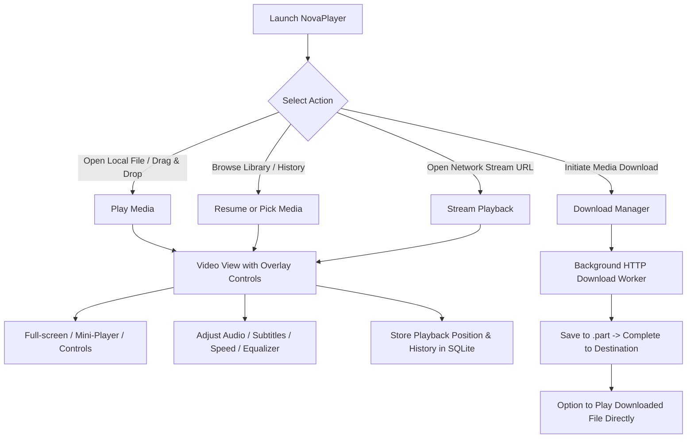

# NovaPlayer — Product Specification

## 1. Executive Summary & Vision

**NovaPlayer** is a modern, responsive, high-performance Windows desktop media player engineered in C# and WPF, powered by the industry-standard LibVLC playback engine. NovaPlayer combines the universal format compatibility and codec resilience of VLC with a sleek, intuitive, fluid user experience adhering to modern Windows desktop ergonomics.

NovaPlayer is designed for users who demand uncompromised playback fidelity for local high-definition media (including Web-DL MKV/MP4 releases), pristine audio management, intuitive library curation, gapless playback history, robust network stream playback, and a safe, resumable media download manager.

---

## 2. Product Goals & Non-Goals

### 2.1 Core Goals
* **Universal Playback Fidelity**: Play virtually any video and audio container/codec combination out of the box without requiring external codec packs, powered by native LibVLC runtimes.
* **Modern Windows Ergonomics**: Deliver a responsive, hardware-accelerated dark/light WPF interface featuring auto-hiding controls, keyboard-driven navigation, drag-and-drop support, and multi-monitor awareness.
* **Intelligent Media Management**: Provide a fast, lightweight SQLite-backed library tracking recently played items, resume points, play counts, favorites, and playlists.
* **Network Stream Playback**: Play direct HTTP/HTTPS media links, HLS (.m3u8), and MPEG-DASH (.mpd) unencrypted streams with real-time buffering telemetry.
* **Compliant Media Downloader**: Allow users to download permitted direct media files with chunked resumption, speed calculation, progress reporting, and security validation.
* **Clean Architectural Separation**: Strict MVVM pattern, testable domain models, dependency injection, and comprehensive structured logging via Serilog.

### 2.2 Non-Goals & Explicit Out-of-Scope Items
* **No DRM Circumvention**: NovaPlayer will strictly NOT bypass DRM systems (Widevine, PlayReady, FairPlay) or decrypt encrypted streams.
* **No Proprietary Platform Scraping**: NovaPlayer will not build fragile scrapers for YouTube, Netflix, Disney+, or proprietary social media sites. Network playback is strictly based on standard direct media URLs and compliant HLS/DASH manifests.
* **No Disc Decryption**: Decryption of commercial copy-protected DVD or Blu-ray discs (CSS/AACS) is not supported.
* **No Transcoding Server**: NovaPlayer is a client player, not a media server (unlike Plex or Jellyfin).

---

## 3. Target Platform & Environment

| Parameter | Specification |
| :--- | :--- |
| **Operating System** | Windows 10 (version 1809 / Build 17763 or higher) and Windows 11 (64-bit recommended) |
| **Architecture** | x64 primary (win-x64), x86 fallback (win-x86) |
| **Runtime Target** | .NET 8.0 Windows Desktop (`net8.0-windows`) as proven LTS baseline, forward-compatible with .NET 10 |
| **UI Framework** | Windows Presentation Foundation (WPF) with modern styling |
| **Engine Runtime** | LibVLC 3.x via `LibVLCSharp.WPF` and `VideoLAN.LibVLC.Windows` (native win-x64 / win-x86 binaries) |
| **Hardware Requirements** | 2.0 GHz Dual-Core CPU, 4 GB RAM, DirectX 11 capable GPU (for hardware decoding) |

---

## 4. User Personas & Core Workflows

### 4.1 Personas
1. **The Cinephile / Web-DL Consumer (Alex)**:
   * Downloads high-bitrate 1080p/4K MKV releases with multi-channel audio (E-AC3, TrueHD) and embedded ASS/PGS subtitles.
   * Values: Perfect subtitle sync, audio track selection, hardware acceleration, aspect ratio control, resume playback.
2. **The Music & Podcast Enthusiast (Maya)**:
   * Plays lossless FLAC, ALAC, and MP3 collections.
   * Values: Equalizer presets, playlist management, mini-player mode, metadata tag display.
3. **The Casual Streamer & Learner (David)**:
   * Pastes direct video/audio URLs or live HLS seminar streams and downloads open-access educational recordings for offline viewing.
   * Values: Quick buffering, playback speed adjustment (1.25x - 2x), download progress tracking.

### 4.2 Key User Workflows

---

## 5. Functional Requirements Breakdown

### 5.1 Category A: Local Media Playback
* **FR-A01 (Format Support)**: Play video containers (MKV, MP4, AVI, WebM, MOV, TS, WMV, FLV) and audio containers (MP3, FLAC, AAC, OGG, WAV, M4A, Opus, WMA).
* **FR-A02 (Playback Controls)**: Play, pause, stop, step forward/backward (5s, 10s, 30s, 60s), seek bar with time elapsed/remaining, volume slider (0-100%, boost up to 125%), mute toggle.
* **FR-A03 (Full-Screen Ergonomics)**:
  * Seamless full-screen toggle via double-click, F11, or `F` key.
  * Auto-hiding control bar after 2.5 seconds of mouse inactivity.
  * Cursor auto-hide in full-screen mode.
  * Escape key exits full-screen.
* **FR-A04 (Keyboard & Mouse Shortcuts)**:
  * `Space`: Play/Pause
  * `Left/Right Arrow`: Seek backward/forward 5s (Ctrl for 30s)
  * `Up/Down Arrow`: Volume up/down 5%
  * `M`: Mute/Unmute
  * `F` / `F11`: Toggle Fullscreen
  * `[` / `]`: Decrease/Increase speed by 0.1x
  * `Backspace`: Reset speed to 1.0x
  * `S`: Cycle subtitle tracks
  * `A`: Cycle audio tracks
  * `Mouse Scroll`: Volume control over video area
* **FR-A05 (Variable Playback Speed)**: Support playback rates from 0.25x to 4.0x with audio pitch compensation enabled by default.
* **FR-A06 (Audio Track Selection & Sync)**: Enumerate all audio tracks; allow runtime switching; offer audio delay adjustment (-5000ms to +5000ms in 50ms increments).
* **FR-A07 (Subtitles)**:
  * Automatic discovery of embedded subtitles (SRT, ASS/SSA, PGS, VobSub).
  * Auto-loading external subtitles matching media filename (`.srt`, `.ass`, `.vtt`, `.sub`).
  * Manual external subtitle file picker.
  * Subtitle delay adjustment (-5000ms to +5000ms).
  * Subtitle text encoding selection (UTF-8, UTF-16, Windows-1252, etc.).
* **FR-A08 (Aspect Ratio & Scaling)**:
  * Options: Default, Fit to Screen, Fill Screen (Crop), 16:9, 4:3, 21:9, 1:1, Original.
* **FR-A09 (Error Handling & Recovery)**:
  * Detect invalid or corrupted media files gracefully.
  * Display an actionable error message dialog without crashing the application.
  * Log detailed LibVLC internal error messages to Serilog.

### 5.2 Category B: Media Library & Persistence
* **FR-B01 (Folder Scanning & Import)**: Select folders to index recursively; monitor folders for changes via `FileSystemWatcher`.
* **FR-B02 (Search & Filtering)**: Instant search filtering by title, artist, album, container, duration, and resolution.
* **FR-B03 (Playlists)**:
  * Create, rename, delete custom playlists.
  * Reorder playlist items via drag-and-drop.
  * Import/Export M3U and M3U8 playlists.
  * Playback modes: Sequential, Repeat All, Repeat One, Shuffle.
* **FR-B04 (Playback History & Resume)**:
  * Automatically record played media, last played timestamp, total play count.
  * Save exact playback position (timestamp in milliseconds).
  * Prompt to resume or auto-resume if previous playback was stopped between 3% and 95% of total duration.
* **FR-B05 (Metadata Extraction)**: Extract title, artist, album, duration, resolution, audio channels, and bitrate using LibVLC media parser.
* **FR-B06 (Application Settings Storage)**:
  * Persist all preferences in SQLite (`app_settings` key-value table).
  * Settings include: default volume, hardware acceleration mode, subtitle encoding, resume behavior, download directory, UI theme.

### 5.3 Category C: Network Streaming
* **FR-C01 (Direct Media URLs)**: Play media directly from HTTP/HTTPS endpoints.
* **FR-C02 (Adaptive Streams)**: Support unencrypted HLS (`.m3u8`) and MPEG-DASH (`.mpd`) streams.
* **FR-C03 (Buffering Telemetry)**: Provide visual buffering percentage and loading spinner during stream buffering.
* **FR-C04 (Network Error Resilience)**: Handle network timeouts, connection drops, and HTTP error codes with user feedback and auto-reconnect option.
* **FR-C05 (Safe Headers & Stream Restrictions)**: Allow custom User-Agent specification; validate safe URL formats; reject non-media/unsupported protocols.

### 5.4 Category D: Media Downloads
* **FR-D01 (Direct Downloads)**: Queue and download permitted direct media files via HTTP/HTTPS GET requests.
* **FR-D02 (Resumable Chunked Downloads)**: Check server `Accept-Ranges: bytes` support; write temporary files to `.part`; resume interrupted downloads seamlessly.
* **FR-D03 (Download Telemetry)**: Real-time progress bar, percentage, downloaded bytes / total bytes, current download speed (KB/s, MB/s), estimated time remaining (ETA).
* **FR-D04 (Queue Management)**: Pause, resume, cancel downloads; configurable concurrent download limit (default: 2 active downloads).
* **FR-D05 (Destination & File Handling)**: Configurable default download directory; validate available disk space before download; automatically rename collisions (`file (1).mp4`).
* **FR-D06 (Security & URL Validation)**:
  * Only allow `http://` and `https://` schemes.
  * Block loopback/private IP addresses (SSRF mitigation) unless explicitly allowed in developer mode.
  * Sanitize output filenames to prevent directory traversal (`../`) or invalid Windows filename characters (`\ / : * ? " < > |`).

### 5.5 Category E: Web-DL & High-Fidelity Media Handling
* **FR-E01 (Web-DL Container Handling)**: Flawless parsing of MKV (Matroska) and MP4 containers produced by modern Web-DL / WEB-Rip workflows.
* **FR-E02 (Modern Codecs)**: Hardware-accelerated decoding of AVC (H.264), HEVC (H.265), VP9, and AV1 video streams.
* **FR-E03 (Surround Audio & Downmixing)**: Support AC3, E-AC3 (Dolby Digital Plus), AAC, Opus, DTS; automatic stereo downmixing for 2.0 speakers or headphones with stereo widening options.
* **FR-E04 (Advanced Subtitle Rendering)**: Accurate rendering of Advanced SubStation Alpha (`.ass`) with styles, colors, positioning, and fonts; support PGS graphic subtitles.
* **FR-E05 (Media Information Dialog)**: Inspector modal displaying detailed video stream specs (codec, profile, width, height, framerate, color space), audio stream specs (codec, sample rate, bit depth, channel layout), and container tags.

### 5.6 Category F: Advanced Playback & Customization
* **FR-F01 (Audio Equalizer)**: 10-band graphic equalizer using LibVLC native equalizer API; built-in presets (Rock, Pop, Classical, Flat, Bass Boost, Vocal Boost); user-custom preset persistence.
* **FR-F02 (Hardware Acceleration Control)**: Toggle hardware acceleration mode in settings: Auto (D3D11VA), DXVA2, or Software (Disabled).
* **FR-F03 (Mini-Player & Picture-in-Picture)**:
  * Compact floating window mode with minimal player controls.
  * "Always on Top" toggle.
  * Drag-to-resize maintaining aspect ratio.
* **FR-F04 (Video Snapshots)**: Take instant video snapshot saved to PNG/JPEG with configurable output folder.
* **FR-F05 (Theming)**: Modern Dark and Light themes with Fluent-inspired controls, accent color customization, and high-contrast support.

### 5.7 Category G: Delivery, Diagnostics & Security
* **FR-G01 (Structured Logging)**: Serilog sink to rolling log files in `%LOCALAPPDATA%\NovaPlayer\logs\` with 14-day retention.
* **FR-G02 (Diagnostics & Crash Handling)**: Global exception handler capturing unhandled UI and background thread exceptions; exportable diagnostic report (OS version, GPU info, LibVLC version, sanitized error stack).
* **FR-G03 (Packaging & Deployment)**: Standalone installer (WiX Toolset v5 / MSI or MSIX) bundling required native LibVLC runtimes; clean uninstall deleting application files while giving option to keep library database.
* **FR-G04 (License Compliance)**: Attribution view in "About" dialog displaying LGPL v2.1 notices for LibVLC and LibVLCSharp, MIT/Apache notices for dependencies, and links to source repositories.

---

## 6. Non-Functional Requirements

| Metric | Target | Verification Method |
| :--- | :--- | :--- |
| **Startup Time** | Cold start < 1.8 seconds; warm start < 800 ms | Benchmark stopwatch on standard SSD |
| **Playback Latency** | Local file playback starts < 300 ms from trigger | Telemetry timestamp from click to `Playing` event |
| **UI Responsiveness** | UI renders consistently at 60 FPS without UI-thread stalls | WPF rendering tier diagnostics, zero dispatcher blocks |
| **Memory Footprint** | Base idle memory < 120 MB; 1080p playback < 350 MB | Process working set telemetry |
| **CPU Utilization** | < 5% CPU on 1080p playback with hardware acceleration | Performance counter tracking |
| **Database Speed** | SQLite queries < 15 ms for library search over 10,000 items | Unit/performance benchmark tests |
| **Reliability** | Zero unhandled crashes; graceful fallback on codec/file failure | Fault-injection testing |
